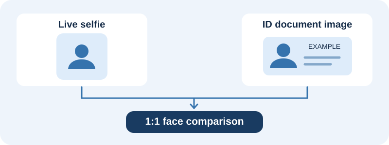
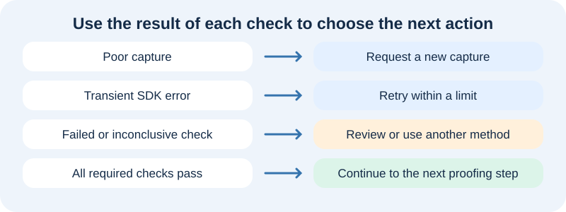

# Match a Selfie to an ID Portrait

Compare a captured selfie with the portrait on the same person’s identity document. This is **1:1 face verification**. The face comparison provides a similarity score. Your application combines it with document validation, any required liveness checks, and your review policy.

<figure><figcaption>Compare the selfie with the portrait from the same verification session. The illustration uses a fictional card.</figcaption></figure>

## <i class="fa-list-check">:list-check:</i> Before you begin

- Use a licensed Face Recognition package and an approved way to obtain the document portrait. Check [Supported Documents](../id-documents/id-document-recognition-sdk/supported-documents.md) for coverage by engine release.
- Decide which face liveness, document liveness, and document validation checks your workflow requires. Set rules for alternative verification and review before handling real submissions.
- Explain why the images are collected, obtain any required consent, and define who can access the images, how long they are retained, and how they are deleted. Build and test with synthetic or authorized fixtures.

## <i class="fa-camera">:camera:</i> Capture and compare

1. **Capture the document.** Ask for a sharp, evenly lit image with all edges visible. Capture the required sides for the document type. Ask for a new image if glare, blur, or clipping obscures the portrait or essential fields.
2. **Obtain the portrait.** Use the portrait from the matching SDK release when it supplies one. If the engine response does not include it, use an authorized portrait crop from the submitted document if your workflow allows it. If a usable portrait is unavailable, stop before comparison. See the [ID Document Recognition API](../id-documents/id-document-recognition-sdk/desktop-and-server/linux/api-reference.md) for the demo response envelope. The portrait field, when available, depends on the engine build.
3. **Capture the selfie.** Guide the user to center one face and use even lighting. Ask for a new capture when the face is blurred, obstructed, or out of frame, or when multiple faces are detected. Keep the document and selfie tied to the same verification session.
4. **Run the required liveness checks.** Use [Face Liveness Detection](../face-biometrics/face-liveness-detection-sdk/desktop-and-server/linux/api-reference.md) on the selfie and [ID Document Liveness Detection](../id-documents/id-document-liveness-detection-sdk/desktop-and-server/linux/api-reference.md) on the document image when required. Record each result separately. A face liveness result describes the selfie capture, and a document liveness result describes the document capture. Apply document validation separately.
5. **Compare the two portraits.** Send the selfie as `image1` and the extracted ID portrait as `image2` to the Linux demo’s `POST /api/compare_face` endpoint using multipart form data. See the [Face Recognition API](../face-biometrics/face-recognition-sdk/desktop-and-server/linux/api-reference.md) for service setup references, the Base64 alternative, and response fields. Read `data.result` and `data.similarity` when available. Treat a missing score or service error as a separate outcome.


Truverion’s Linux demo services expose individual checks. Your application coordinates the session, passes results between steps, and applies the final verification policy.


## <i class="fa-code-branch">:code-branch:</i> Handle the outcome

<figure><figcaption>Choose the next action based on the type of result.</figcaption></figure>

| Result | Application action |
| --- | --- |
| Image quality is insufficient | Give specific capture guidance and allow a limited number of recaptures. |
| Required liveness or document validation fails | Stop automatic progression. Apply your review or alternative verification policy. |
| Face similarity falls below the configured threshold | Record a non-match. Use your review or alternative verification policy for unresolved cases. |
| SDK unavailable or request times out | Record a technical error. Use a bounded retry for transient failures and offer an alternative if the service stays unavailable. |
| Face comparison and all other required checks pass | Continue to the next step in your proofing workflow. |

## <i class="fa-sliders">:sliders:</i> Calibrate and test

- Treat the similarity score as a model output. Select a decision threshold using representative selfie and ID portrait pairs, then evaluate on a separate set with different identities. Record the false match rate for different-person pairs and the false non-match rate for same-person pairs.
- Test supported document types, capture devices, lighting, portrait age, and image quality. Track capture failures and technical errors separately from comparison errors. Revalidate the operating threshold when the SDK or capture pipeline changes.
- Keep raw images, face templates, and ID fields out of routine logs. Use redacted diagnostic details when requesting support.

See the [Face Recognition performance guide](../face-biometrics/face-recognition-sdk/performance-overview.md) and [NIST Digital Identity Guidelines for Identity Proofing and Enrollment](https://pages.nist.gov/800-63-4/sp800-63a.html) for evaluation and proofing guidance. For package access or integration questions, see [Contact & Support](../resources-and-support/contact-and-support.md).
