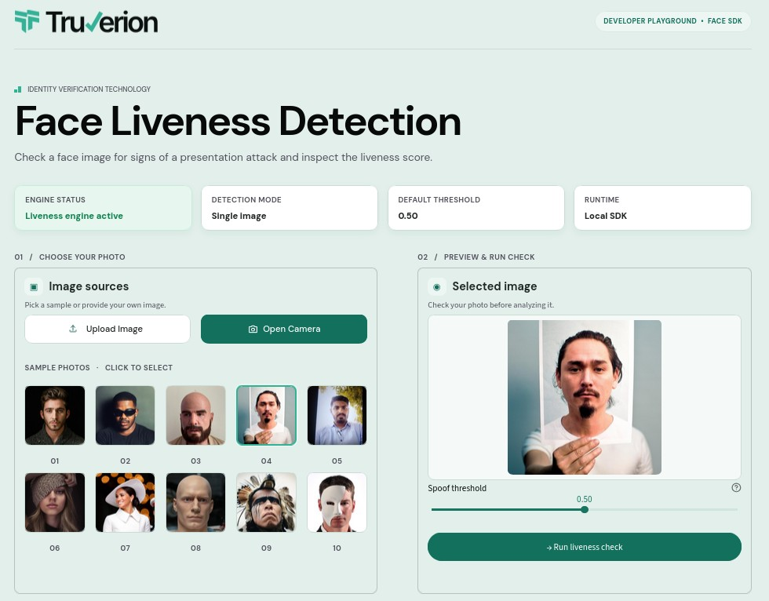
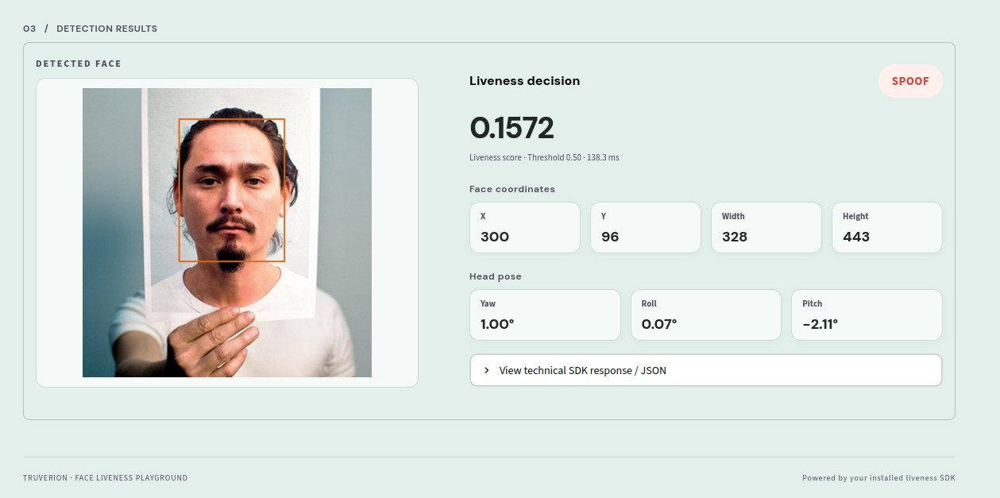
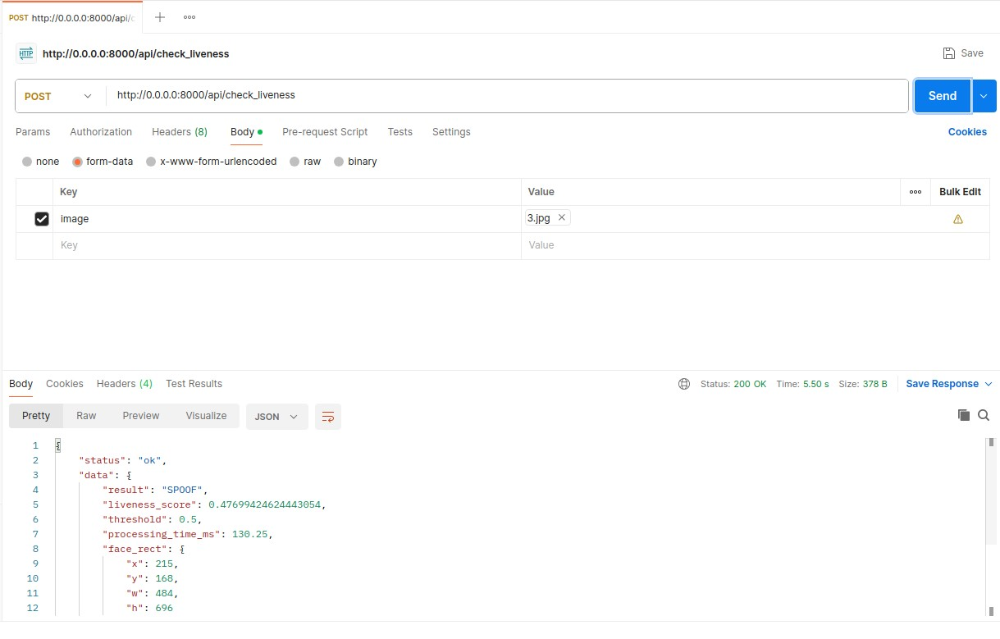

# Sample Application

Run the Linux demo to check face liveness from a single image and review the liveness score.

<a href="https://drive.google.com/file/d/1jQHhBssZCnzbcEeBczk03OjLRJOzrhcB/view?usp=sharing" class="button primary">Download the Linux Demo →</a>

### Before you begin

Complete [Installation](installation.md) and [Licensing & Activation](licensing-and-activation.md). Open a terminal in the demo directory.


```
chmod +x *.sh
./install.sh
```


### Run the Demo




```
./run_all.sh -s
```


1. Open the Local URL shown in the terminal.
2. Upload an image or capture a photo.
3. Run the check and review the result and liveness score.

<figure><figcaption>Face Liveness Detection Streamlit demo.</figcaption></figure>

<figure><figcaption>Face Liveness Detection demo walkthrough screenshot 2.</figcaption></figure>




```
./run_all.sh -f
```


1. Copy the server URL shown in the terminal.
2. In Postman, send `POST /api/check_liveness` with one file in the image field.&#x20;
3. Review the result and liveness score.

<figure><figcaption>Face Liveness Detection demo walkthrough screenshot 3.</figcaption></figure>



## <i class="fa-circle-check">:circle-check:</i> Check the result

Expect a liveness result and score when available. Ask for a new capture if the face is obscured or missing. For the request fields and error responses, see the [API reference](api-reference.md).
