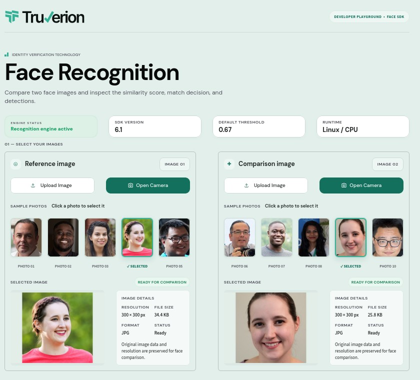
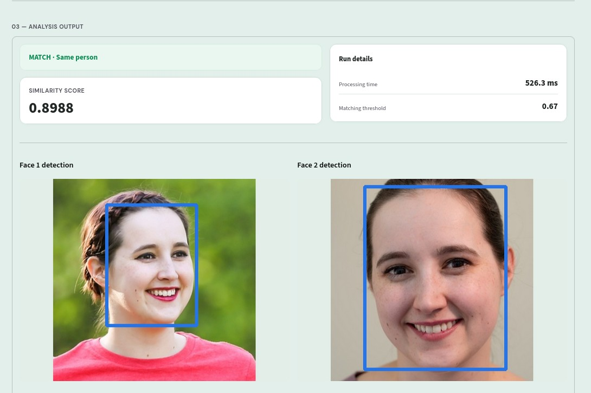
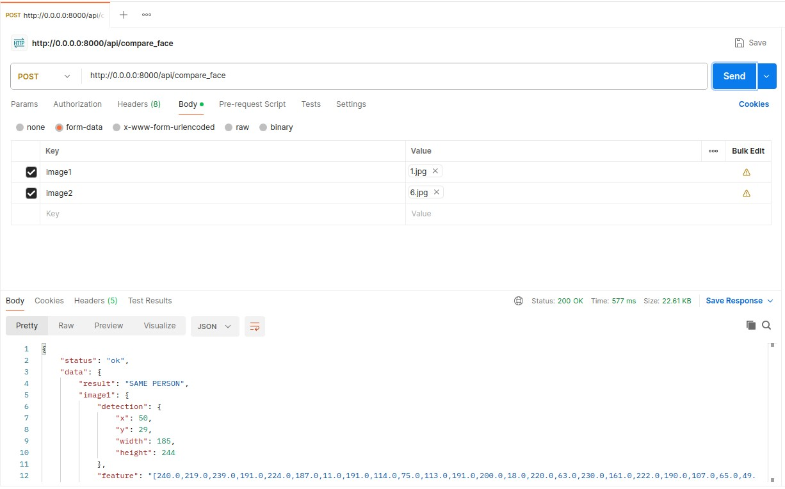

# Sample Application

Run the Linux demo to compare two face images and review the similarity score.

<a href="https://drive.google.com/file/d/1wYg0n7q7mqkXGTgZkhw9XR-dXGjTPRJ1/view?usp=sharing" class="button primary">Download the Linux Demo →</a>

### Before you begin

Complete [Installation](installation.md) and [Licensing & Activation](licensing-and-activation.md). Open a terminal in the demo directory.


```
chmod +x *.sh
./install.sh
```


### Run the Demo




```
./run_all.sh -s
```


1. Open the Local URL shown in the terminal.
2. Select a reference image and a comparison image.
3. Run the comparison and review the similarity score and math result.

<figure><figcaption></figcaption></figure>

<figure><figcaption></figcaption></figure>




```
./run_all.sh -f
```


1. Copy the server URL shown in the terminal.
2. In Postman, open the face comparison and attach both image as from-data files.
3. Send the request and review the math result and similarity score

<figure><figcaption></figcaption></figure>




