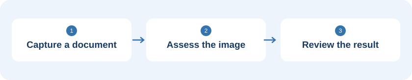

# ID Document Liveness Detection SDK

Use this SDK to evaluate the liveness of a document image. Expect a document liveness assessment when the image can be processed when the input can be processed.

## <i class="fa-compass">:compass:</i> Choose a starting point

| Goal | Start here |
| --- | --- |
| Run the Linux demo | [Install the demo](desktop-and-server/linux/installation.md) and [run a sample](desktop-and-server/linux/sample-application.md) |
| Integrate with FastAPI | [Read the API reference](desktop-and-server/linux/api-reference.md) |
| Evaluate the output | [See the evaluation guide](performance-overview.md) |

For a combined verification flow, see [Match a Selfie to an ID Portrait](../../build-a-workflow/match-a-selfie-to-an-id-portrait.md).
