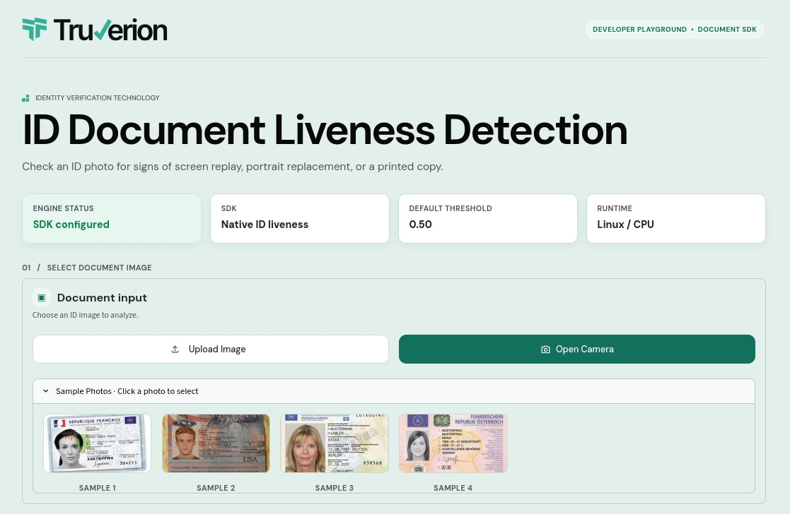
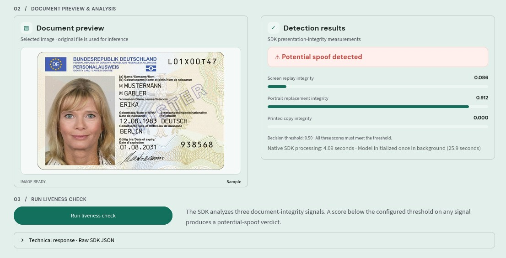
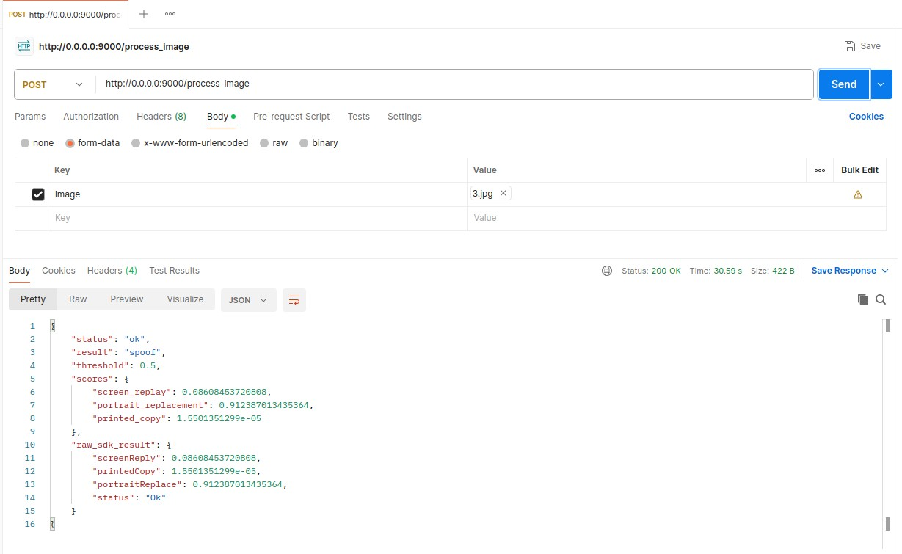

# Sample Application

## ID Document Liveness sample application

Run the Linux demo to check an ID document image and review the liveness result.

<a href="https://drive.google.com/file/d/1h3wTWf0ujf6sJPvcQDIQ97qbwW0CIAlJ/view?usp=sharing" class="button primary">Download the Linux Demo →</a>

### **Before you begin**

Complete <mark style="color:$primary;">installation</mark> and <mark style="color:$primary;">Licensing & Activation</mark>. Open a terminal in the demo direcotory.

### **Run the demo**




```
./run_all.sh -s
```


1. Open the Local URL shown in the terminal.
2. Upload a sample ID document image.
3. Run the check and review the liveness result.

<figure><figcaption></figcaption></figure>

<figure><figcaption></figcaption></figure>




```
./run_all.sh -f
```


1. Copy the Server URL shown in the terminal.
2. In Poastman, send `Post /process_image` with the image of ID in `image`.
3. Review the result.

<figure><figcaption></figcaption></figure>




