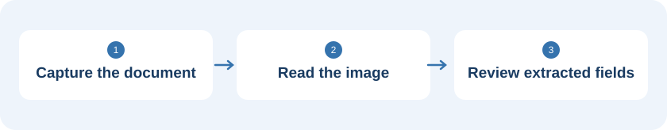

# ID Document Recognition SDK

Use this SDK to read supported fields from an identity document. Extracted fields supported by the engine release is the expected output when the input can be processed.

## <i class="fa-compass">:compass:</i> Choose a starting point

| Goal | Start here |
| --- | --- |
| Run the Linux demo | [Install the demo](desktop-and-server/linux/installation.md) and [run a sample](desktop-and-server/linux/sample-application.md) |
| Integrate with FastAPI | [Read the API reference](desktop-and-server/linux/api-reference.md) |
| Build a mobile sample | [Android](mobile/android/README.md) · [iOS package guidance](mobile/ios/README.md) |
| Evaluate the output | [See the evaluation guide](performance-overview.md) |

See [Supported Documents](supported-documents.md) before selecting test fixtures.
