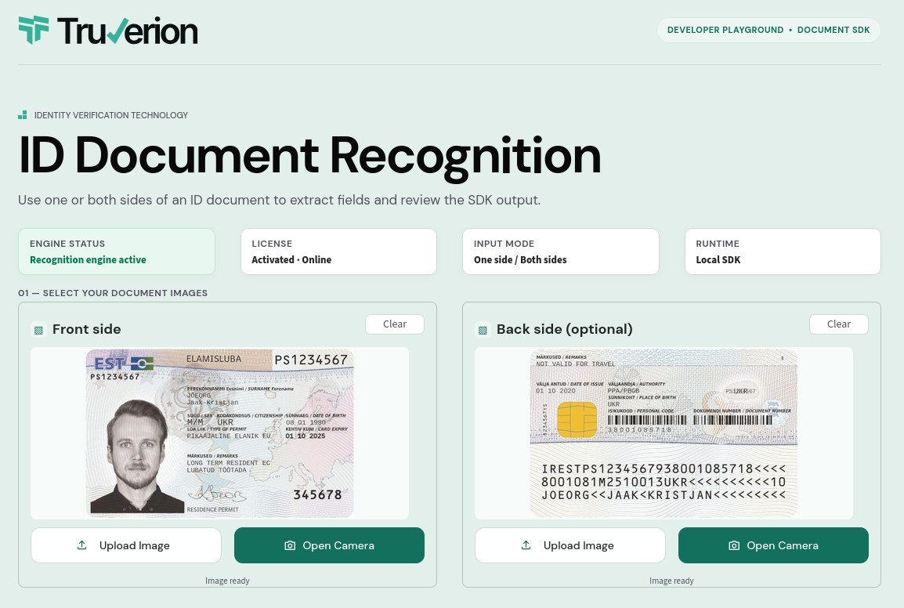
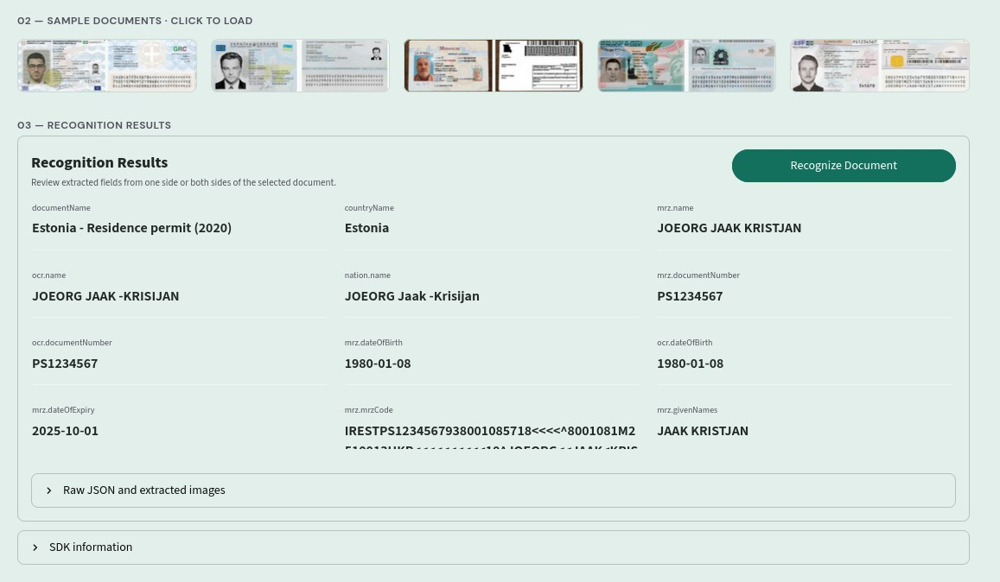
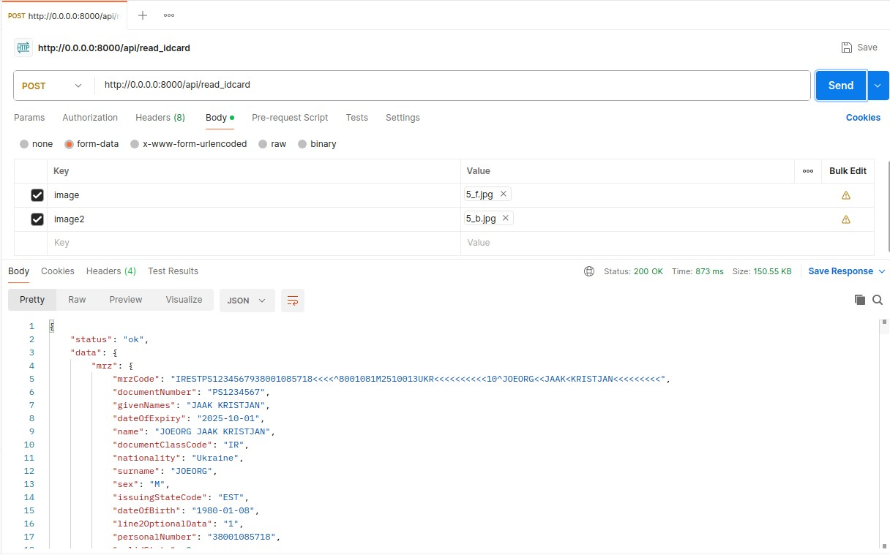

# Sample Application

## **ID Document Recognition sample application**

Run the ID Document Recognition demo on Ubuntu 22.04 LTS.

To obtain the demo package, [contact Truverion](../../../../resources-and-support/contact-and-support.md).

### Before you begin

Complete [Installation](installation.md) and [Licensing & Activation](licensing-and-activation.md). Open a terminal in the demo directory.


```
chmod +x *.sh
./install.sh
```


### Run the demo




```
./run_all.sh -s
```


1. Open the Local URL shown in the terminal
2. Upload or Capture the front image. Add the back image if needed
3. Run recognition and review the extracted fields.

<figure><figcaption>ID Document Recognition Streamlit demo.</figcaption></figure>

<figure><figcaption>ID Document Recognition demo walkthrough screenshot 2.</figcaption></figure>




```
./run_all.sh -f
```


1. Copy the Server URL shown in the terminal.
2. In Postman, send `POST /api/read_idcard` with the front image in `image` and the optional back image in `image2`.
3. Review the extracted document fields.

<figure><figcaption>ID Document Recognition demo walkthrough screenshot 3.</figcaption></figure>



## <i class="fa-circle-check">:circle-check:</i> Check the result

Expect extracted fields supported by the engine release. Use a sample document with clear edges and readable text. For the request fields and error responses, see the [API reference](api-reference.md).
